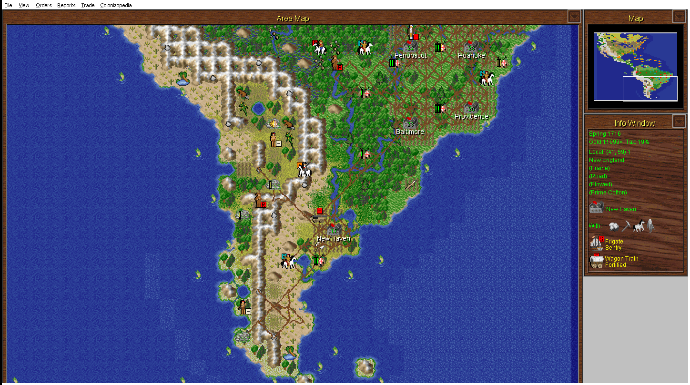
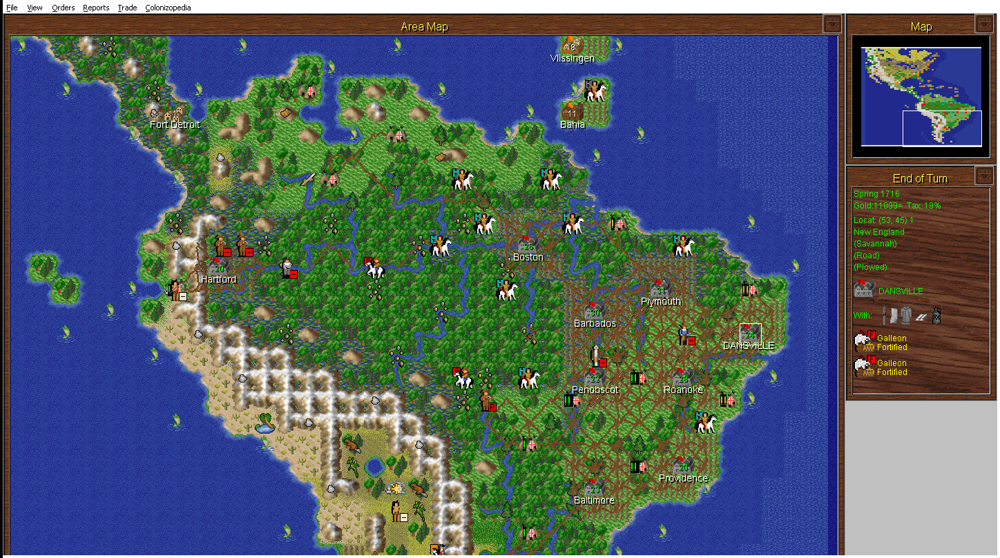
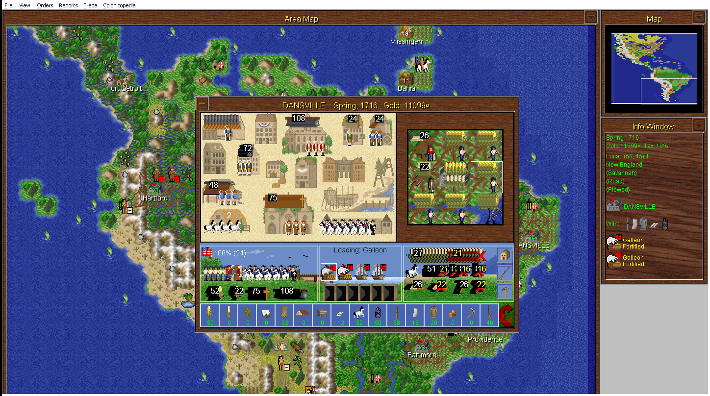
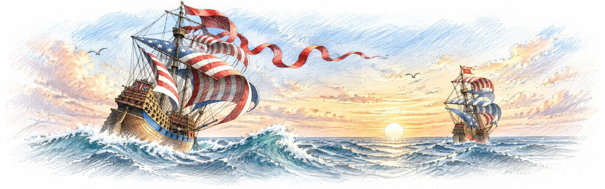

  
  
  

The 1995 Windows game, running in <a href="https://github.com/OpenCol/win-port">win-port</a>.

# OpenCol — Bringing Sid Meier's Colonization Back to Life

**Preserving the original. Reconstructing its source code. Building its future.**

OpenCol is an open-source community around **Sid Meier's Colonization (1994)**: we rebuild the original DOS and Windows 3.1 games from their own code so they run on today's computers, document how they work, and make tools for maps, saved games and modding.

## Play it

You need your own copy of the game. Both stores sell the original 1994 *Classic* game, and it works with everything below:

| Store | Game |
| --- | --- |
| **Steam** | [Sid Meier's Colonization (Classic)](https://store.steampowered.com/app/327400/) |
| **GOG** | [Sid Meier's Colonization](https://www.gog.com/en/game/sid_meiers_colonization) |

Make sure you buy the 1994 game, not *Civilization IV: Colonization* (2008).

- **[Colonization for Windows, ported](https://github.com/OpenCol/win-port)**: the 1995 Windows game rebuilt as a native program, with no emulator. It runs on Windows 7 to 11, and on macOS and Linux through Wine. It has the same rules, pictures, music and saved games, and the Steam or GOG copy already contains the Windows edition. **[Download](https://github.com/OpenCol/win-port/releases)**
- **[win31-runtime](https://github.com/OpenCol/win31-runtime)**: runs the original 16-bit Windows program itself on a modern computer.
- **[win-patches](https://github.com/OpenCol/win-patches)**: community patches for the original Windows game: animated water, bug fixes and hidden features. **[Download](https://github.com/OpenCol/win-patches/releases/latest)**
- **OpenCol** *(in development, not public yet)*: the community edition. The DOS game is rebuilt as a modern program that plays exactly like the original, with fixes and new features as options you choose. Follow it on [Discord](https://discord.gg/4XP4S9yfJ8).

## Make and share maps

- **[Map Editor](https://github.com/OpenCol/mapedit)**: the original DOS map editor, running natively on macOS and Windows without DOSBox. It has the same screens, keys and menus, and saves byte-identical `.MP` maps. **[Download](https://github.com/OpenCol/mapedit/releases/latest)**
- **[Map Archive](https://opencol.github.io/maps/)**: community maps and scenarios, including maps from sites that have disappeared. You can **[submit your own](https://github.com/OpenCol/maps/issues/new?template=map_submission.yml)**.
- **[fsm-to-mp](https://github.com/OpenCol/fsm-to-mp)**: converts FreeCol `.fsm` maps into classic `.MP` maps.

## Read how it works

- **[Documentation](https://opencol.github.io/docs/)**: how the game really works, read out of its own code. It covers map generation, combat, taxes, Founding Fathers and difficulty, the `.SAV` and `.MP` formats, every DOS and Windows file format, and how the versions differ.
- **[Savegame Editor](https://opencol.github.io/sav-editor/)**: reads and edits `.SAV` saved games in your browser.

## Under the hood

- **Source reconstructions** *(not public yet)*:
  - **win-decomp**: the Windows 3.1 game, rebuilt byte-for-byte from the original program.
  - **dos-decomp**: the DOS game, rebuilt from the original program.
  - **mapedit-decomp**: the DOS map editor, which compiles with Microsoft C 6.00A to the same machine code as the shipped program and uses the developers' own function names.
- **[dos-tools](https://github.com/OpenCol/dos-tools)**: extracts, modifies and rebuilds the DOS game's graphics, palettes and text, and previews maps and saved games.
- **[win-tools](https://github.com/OpenCol/win-tools)**: extracts, converts and rebuilds the Windows release's assets.
- **[web-ui](https://github.com/OpenCol/web-ui)**: the shared styles behind the OpenCol websites.

## How to help

Players, modders, artists, reverse engineers and historians are all welcome.

- **Talk to us** on **[Discord](https://discord.gg/4XP4S9yfJ8)**: development, discoveries, and what to fix next.
- **Report a bug** in the issues of the project it affects, for example [win-port](https://github.com/OpenCol/win-port/issues) or [mapedit](https://github.com/OpenCol/mapedit/issues).
- **Share a map** through the [submission form](https://github.com/OpenCol/maps/issues/new?template=map_submission.yml), or send us an old one you still have.
- **Improve the documentation**: [docs](https://github.com/OpenCol/docs) is plain Markdown, and corrections and findings are welcome.
- **Meet other players** on **[r/ColonizationGame](https://www.reddit.com/r/ColonizationGame/)**.

---

*OpenCol is an independent fan-made project and is not affiliated with or endorsed by the original creators or rights holders. No original game files are distributed: you need your own legally obtained copy of the game.*
